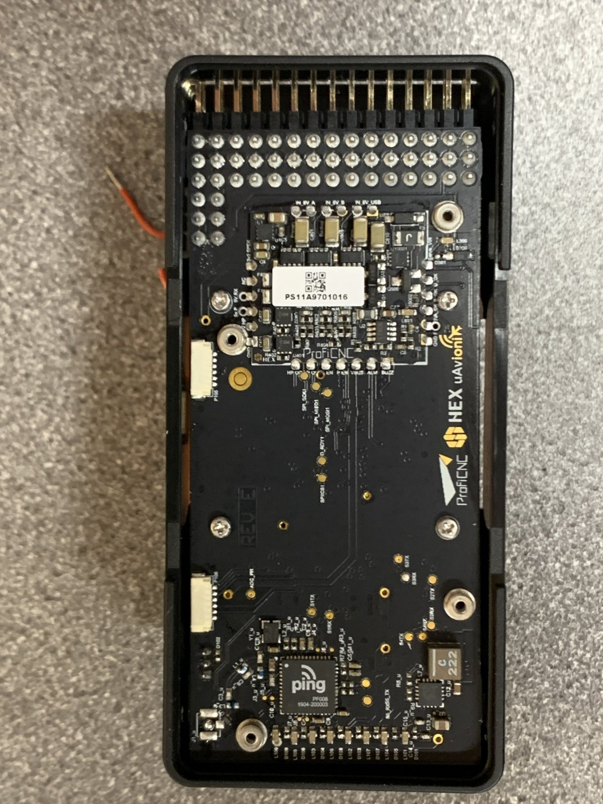
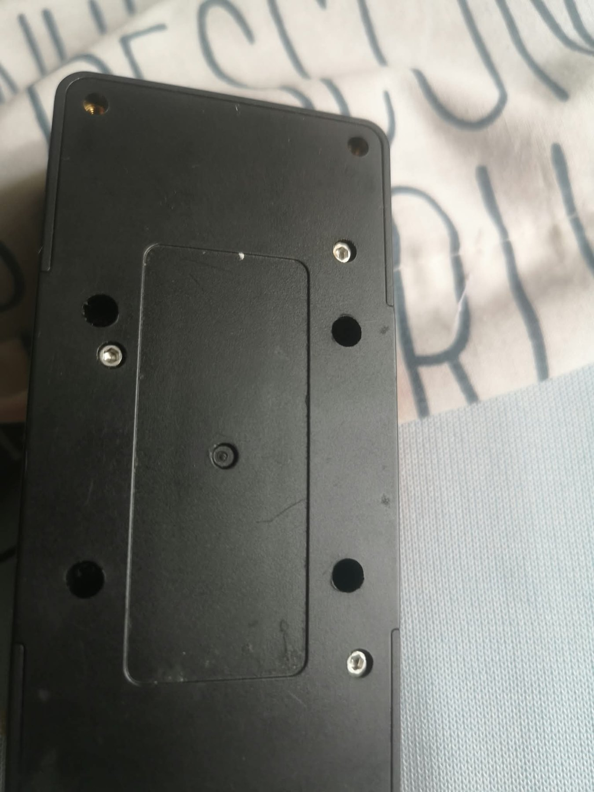
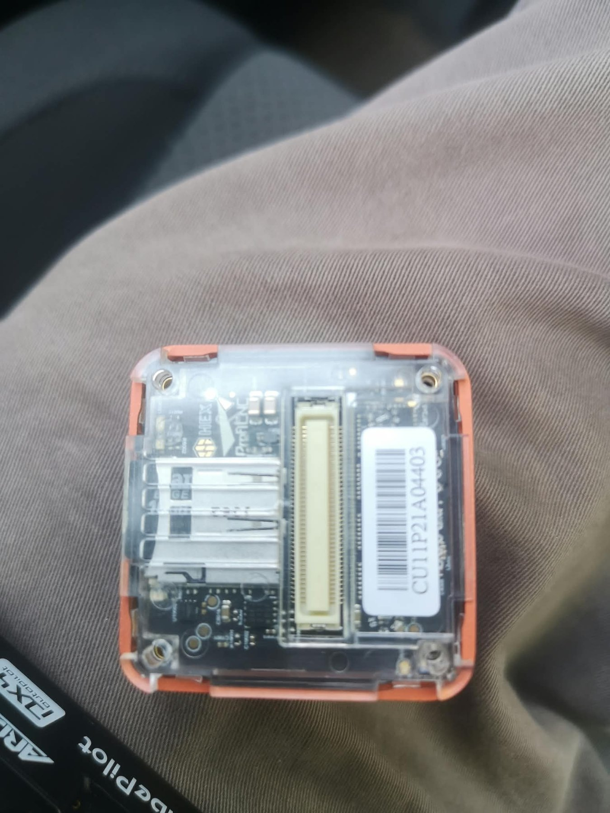
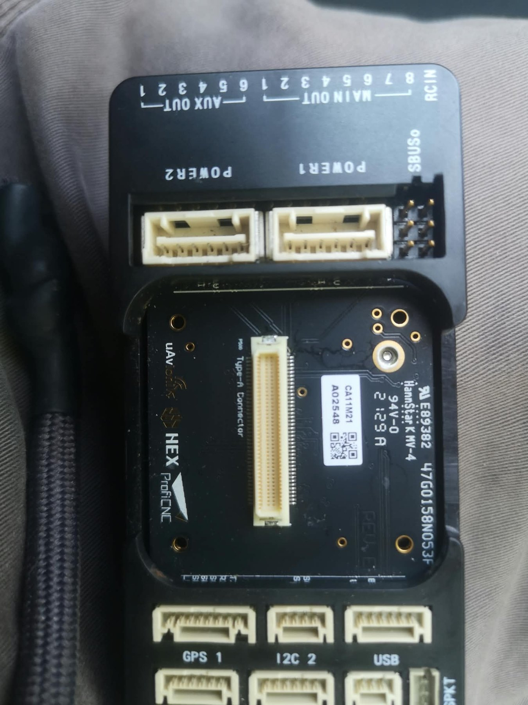

# Cube Orange Original — IOMCU SWD Diagnosis and Bootloader Recovery Research

**Status:** Investigation and procedure proposal — **NOT a validated flashing guide**  
**Last updated:** 18 October 2026  
**Target:** CubePilot **Cube Orange original** (not Orange+), FMU bootloader board ID **140**, HEX/ProfiCNC carrier  
**Repository:** [jcarpio/Cube-Orange-IOMCU-Recovery](https://github.com/jcarpio/Cube-Orange-IOMCU-Recovery)

> [!CAUTION]
> This particular flight controller exhibits an unresponsive IOMCU, watchdog/crash evidence, and IMU temperature readings up to **77.274 °C** during an ArduPilot calibration session. Do not use it to control motors or safety-critical machinery. **Do not erase, unlock, write, or flash either MCU based solely on the candidate pinout or file names below.** Identify the actual target MCU, PCB revision, electrical connections, flash layout and bootloader compatibility first. Avoid exposed probes on the 80-pin DF17 connector.

## Executive summary

The Cube Orange uses two distinct processing domains: the flight management unit (**FMU**) and the input/output microcontroller (**IOMCU**). The FMU starts, takes PX4/ArduPilot firmware and reads inertial sensors, whereas the IOMCU consistently fails firmware update or communication. A CubePilot/ArduPilot developer explains that the **IOMCU bootloader can be installed using a hardware debugger such as ST-Link**, after which the FMU transfers the IOMCU application firmware over a UART. This makes SWD a *credible recovery path*, but does not establish that the bootloader is the defective component.

The standard Cube documentation specifies separate six-position **IO DEBUG** and **FMU DEBUG** ports. Community reports show such ports on the **underside of certain carrier PCBs**. Our carrier has been opened and photographed; **no IO DEBUG connector or specific SWD pads are yet conclusively identified in that photograph**. Pin numbers and package descriptions below are **reference data pending continuity/schematic verification**, not a wiring instruction for this exact PCB.

**Recommended next action:** request the exact HEX/ProfiCNC carrier revision schematic or vendor pinout, identify the IO DEBUG port, obtain the keyed matching cable, and perform **non-destructive SWD target detection only**. Do not program anything until the exact IOMCU chip and bootloader image are proven compatible.

## 1. Scope, exclusions and evidence levels

- **Observed:** established by the local test session, photographs, screenshots, or firmware metadata.
- **Documented:** stated in official CubePilot/ArduPilot documentation or by named developers on their forums.
- **Hypothesis:** plausible but not established; requires testing.
- **Unverified:** unknown for this particular Cube Orange / carrier revision.

The public threads involve **Cube Orange, Orange+ and Cube Black** devices. Do not assume their internal PCB layout, MCU type, flash sector map or recovery image is interchangeable. The Cube's **FMU bootloader** is distinct from its **IOMCU bootloader**. ArduPilot's common DFU instructions and `CubeOrange_bl.*` artifacts generally concern the *FMU* and are **not** an IOMCU fix.

## 2. Confirmed local observations

| Test / environment | Observed outcome | What it does / does not prove |
|---|---|---|
| PX4 1.17 Build A, PX4IO enabled | I/O CRC/update/init failed | PX4IO setup failed; does not uniquely identify bootloader damage |
| PX4 Build B, PX4IO disabled | Two IMUs were readable | The FMU and some IMUs operate independently of IO |
| PX4 experimental Build C `px4io probe` | `IOMCU communication failed: -1`; 3 retries, 2 timeouts, 1 DMA error, 1 UART error | Direct *read-only* register exchange unsuccessful; suggests transport/target issue |
| ArduPilot Rover 4.6.3, `BRD_IO_ENABLE=1` | `Failed to update IO firmware` | Ordinary update path fails |
| ArduPilot Rover, `BRD_IO_ENABLE=0` | IMUs readable; MAIN outputs depend on IO and would not function | Disabling IOMCU isolates a functional FMU/IMU path; does not repair IO |
| ArduPilot Rover, `BRD_IO_ENABLE=2` | IMUs readable; no forced IO firmware update at startup | Does **not** demonstrate successful IO communication |
| ArduPlane stable official | Same I/O firmware error after installing/booting | Failure is not restricted to Rover firmware |
| Safety-switch force-update attempt | Same configuration error afterwards | Attempt did not confirm an IO recovery |
| `BRD_HEAT_TARG=28 °C` | IMU3 reached 75.55 °C in MAVLink and 77.274 °C at gyro calibration reference | Temperature setpoint is not evidence of active regulation; temperature fault unresolved |
| ArduPilot crash evidence | `WDG` messages and `APM/crash_dump.bin` available | There is crash evidence but it has not been unambiguously linked to IO |

### Local PX4 Build C probe output (representative)

```text
ERROR [px4io] IOMCU communication failed: -1
px4io: retries: 3 events
px4io: timeouts: 2 events
px4io: crcerrs: 0 events
arch_px4io_serial: DMA errors: 1 events
px4io: protoerrs: 0 events
px4io: uarterrs: 1 events
```

These counters are from one custom probe session, not a continuous statistical characterization of the link.

## 3. Why external SWD is relevant

Simplified architecture:

```text
                         Cube Orange module
       +---------------------------------------------+
       | FMU (STM32H7)                              |
       | PX4 / ArduPilot, sensors, bootloader        |
       |      |                                      |
       |      | internal UART (FMU <-> IOMCU)        |
       |      v                                      |
       | IOMCU                                      |
       | ROM boot/flash + application               |
       +-------------------+-------------------------+
                           |
                   80-pin DF17 interface
                           |
                 HEX/ProfiCNC carrier PCB
                   |                 |
               IO DEBUG          FMU DEBUG
             (target IOMCU)      (target FMU)
                   |
              SWD adapter
```

As [ArduPilot developer Andrew Tridgell explains](https://discuss.ardupilot.org/search?q=%22IOMCU%20source%20code%22), a hardware debugger is used for initial IOMCU bootloader programming; thereafter the FMU normally loads the I/O application firmware over UART from embedded ROMFS. This is conceptually different from programming the FMU with an ArduPilot `.apj`, `.hex` or FMU bootloader image.

A healthy response to SWD would show only that the IOMCU's debugging access works. It would **not automatically prove UART, IO application, PWM, reset control, or thermal management are working**.

## 4. Physical evidence: our actual carrier and Cube

### Figure 1 — underside of the actual HEX/ProfiCNC carrier PCB, cover removed



**Source:** owner-supplied photograph. The PCB shows a 3-row area of soldered connector contacts near the top, gold test pads in the center, and small white connectors at the edges. **No specific gold pad or white socket has yet been proven to be IO SWD.** Avoid assigning `IO_SWDIO` / `IO_SWCLK` from appearance alone. This image documents the search area, not verified connection points.

### Figure 2 — carrier's underside before removing the plastic cover



The screw-on cover conceals the PCB. Remove it only with all power disconnected. Keep track of screws, spacers and protective insulation.

### Figure 3 — underside of the Cube Orange module



The Cube module itself is **not** the carrier. Unlabelled gold circles on the Cube are **not** identified SWD points. No clip-on probe should be used across the 80-pin connector.

### Figure 4 — carrier top / connection layout



Used only to describe the physical assembly. Do not confuse the RCIN/MAIN/AUX pin headers with SWD debug ports.

### External photographs and possible connector locations

The [CubePilot ADS-B carrier development thread](https://discuss.cubepilot.org/t/developing-for-cube-orange-with-ads-b-carrier/3135) contains an **underside-of-carrier reference photograph** shared by `MadRC` (post 4, April 2020). In post 7 (2022), `joshanne` says the debug connectors are on the **left** of that photograph, and tentatively suggests the FMU debug might be `P108`—**not a confirmed identification**. This may help locate the pair on some carrier revisions, but cannot label our own pads.

The [Cube Orange+ DFU/SWD thread](https://discuss.cubepilot.org/t/how-to-activate-dfu-mode-on-cube-orange/12704/2) includes developer-supplied photos and pinout of debug ports under the carrier cover. **Most repair commands in that discussion target the FMU of an Orange+**, not this Cube Orange IOMCU.

## 5. Official connector and 80-pin interface references

Official pin definitions: [CubePilot — The Cube Module Overview](https://docs.cubepilot.org/user-guides/autopilot/the-cube-module-overview).

### Six-position IO DEBUG connector (official generic Cube interface)

| Position | Label in CubePilot documentation | Purpose / caution |
|---:|---|---|
| 1 | `VDD 5V PEIPH` (as spelled in source) | **5 V peripheral power, NOT 3.3 V VTref by assumption** |
| 2 | `IO_TX` | IOMCU UART TX, not SWD |
| 3 | `IO_RX` | IOMCU UART RX, not SWD |
| 4 | `IO-SWDIO` | SWD bidirectional data |
| 5 | `IO-SWCLK` | SWD clock |
| 6 | `GND` | Ground |

The documentation also describes an analogous **FMU DEBUG** port; same-looking connector, **different processor**. The mating **connector family and exact part/shell** must be verified. The forum references `SM06B-SURS-TF(LF)(SN)-ND` (often the PCB header); do not assume this is the complete mating cable or shell part number.

### Relevant 80-pin DF17 signals (official module overview)

| DF17 pin | Net | Purpose |
|---:|---|---|
| 69 | `IO_SWDIO` | IOMCU SWD data |
| 71 | `IO_SWCLK` | IOMCU SWD clock |
| 75 | `IO_!RESET` | IOMCU reset; optional for advanced recovery |
| 1 | `FMU_SWDIO` | **FMU only** |
| 3 | `FMU_SWCLK` | **FMU only** |
| 7 | `FMU_!RESET` | **FMU only** |

These pins establish a possible breakout design, **not a recommendation to contact the DF17 directly**. Before a custom breakout is fabricated, verify gender, stack height, PCB pad footprint, power nets, trace continuity, and the specific carrier/Cube revision. Do not guess a 3.3 V rail from a generic drawing.

### Electrical warning

The published IO DEBUG pin 1 is **5 V**. Some debug adapters use a target reference-voltage sense pin expecting a specific voltage range; others may source power. Do **not** bridge that 5 V line to an assumed 3.3 V reference, SWDIO or debugger output. Use a compatible correctly wired adapter or professionally verified level/reference arrangement. Keep the debugging session isolated from motors and external batteries.

## 6. Tooling and preparations

| Item | Purpose | Notes |
|---|---|---|
| Authentic ST-LINK/V3 or compatible ST-LINK/V2, J-Link or Black Magic Probe | SWD probe | Select a known-supported tool and software; avoid uncertain clone pinouts |
| Correct *mating* fine-pitch six-position connector/cable | Keyed, repeatable carrier connection | Confirm with PCB header datasheet and actual connector photograph |
| Mac or Ubuntu host | Programmer tool host | STM32CubeProgrammer or OpenOCD; install official toolchain |
| ESD-safe, nonconductive work surface | Handling | Disconnect USB, batteries, external electronics during cable preparation |
| Known carrier schematic and IO MCU ID | Critical prerequisite | Must be resolved **before** flashing |
| Optional USB voltage/current meter | Non-invasive power comparison | Does not prove IOMCU or heater regulation |

Official tooling references:

- [STM32CubeProgrammer](https://www.st.com/en/development-tools/stm32cubeprog.html)
- [OpenOCD](https://openocd.org/)
- [ST-LINK/V3](https://www.st.com/en/development-tools/stlink-v3set.html)

## 7. Safe staged diagnostic and recovery workflow

**Do not start the electrical stage until the actual carrier connector and voltage reference are verified.** The steps below deliberately separate *hardware assessment* from *destructive programming*.

### Stage 0 — preserve evidence (no power required)

1. Back up firmware artifacts, PX4 diagnostic patches, ArduPilot parameters, crash dump, and owner-provided carrier photos.
2. Record actual module variant (**Cube Orange original, board ID 140**) and carrier revision from serigraphy or vendor record.
3. Preserve any available boot log; do not clear CrashDump before archiving.
4. Note that earlier overtemperature readings make powered bench testing inappropriate until thermal risk is addressed.

### Stage 1 — identify physical debug interface (power OFF)

1. Match the actual PCB against manufacturer documentation, *not* just another community user's image.
2. Identify the two similar six-position debug ports, if fitted. Document which is **IO DEBUG** versus **FMU DEBUG**, including pin-1 orientation.
3. Verify connector family and cable pin mapping **end to end**, ideally with an independent technician and schematic; no loose metal clips across DF17 pins.
4. Confirm that the proposed interface does not unintentionally feed 5 V into the debugger or target.

**Gate:** no wiring without verified pinout and safe target reference. The current owner photo does **not** satisfy this gate.

### Stage 2 — non-destructive SWD identification (only after Stage 1)

1. Configure the programmer in **SWD** mode with read-only/identify intentions and conservative interface speed; use the *IOMCU*, not the H7 FMU, target configuration.
2. Power the target using the manufacturer-supported arrangement, monitoring for rapid heating. Avoid unverified dual powering.
3. Attempt **Connect / Read device ID**. Record target identification, voltage, access errors and reset state. Do **not** issue erase, mass-erase, unprotect, write, option-byte change, or firmware load commands.
4. If the target is not detected, stop. Re-check connector identity, power/reference, ground, clock, reset, solder joints, and target MCU family.
5. If detected, seek a proper flash map and secure backup method. Readout protection may prevent a backup; do **not** disable protection to obtain one because that may erase flash.

**Success here means SWD access, not repaired I/O.** If no access is possible, a known-good carrier comparison and vendor service are preferable to escalating unverified probes.

### Stage 3 — image selection and compatibility verification

Before any write, establish **all** of the following:

- Exact IOMCU chip family, part number, boot clock and flash geometry.
- Correct bootloader load address and application start address for that hardware revision.
- Vendor/developer endorsement of the exact image and its provenance/checksum.
- Whether any factory parameters, unique data or protection sectors require preservation.
- How success/failure will be checked via bootloader handshake and I/O protocol, not only LEDs.
- A recovery route if the unit becomes unresponsive; a programmer connection alone is not such a guarantee.

#### Critical historical-bin compatibility trap

The current [ArduPilot `Tools/bootloaders/README.md`](https://github.com/ArduPilot/ardupilot/blob/master/Tools/bootloaders/README.md) specifically labels **`iomcu_bl.bin` as an older bootloader *for the IOMCU on fmuv2***. The file exists in the official [Bootloaders downloads](https://firmware.ardupilot.org/Tools/Bootloaders/), but this provenance **does not prove it matches Cube Orange original**. Another image `iomcu_f103_8MHz_bl.bin` also exists. Do **not** flash either by filename similarity alone.

Likewise, `CubeOrange_bl.bin`, `CubeOrange_bl.elf`, `CubeOrangePlus_bl.elf`, `arduplane_with_bl.hex`, and generic STM32 DFU instructions refer to **FMU-side** bootloaders/firmware and are **not appropriate replacements for the IOMCU bootloader**.

### Stage 4 — optional controlled programming (NOT AUTHORIZED BY THIS DOCUMENT)

Once stages 1–3 are confirmed with an exact target-specific written plan and independent review:

1. Archive existing flash **if readable and legally/technically possible**.
2. Verify the exact image cryptographic digest and planned target addresses.
3. Apply the minimum necessary bootloader programming operations with a validated debugger configuration.
4. Verify programmed contents using target-specific verification and power-cycle behavior.
5. Allow ArduPilot's FMU to load the IOMCU **application** firmware through its ordinary UART-based mechanism; do **not** independently program an arbitrary I/O application binary.
6. Re-check I/O protocol, main outputs in a **safe isolated test fixture**, watchdog behavior and thermal stability before declaring success.

There are intentionally **no generic `mass_erase`, `load`, `flash write_image`, or `unlock` commands** here. The publicly documented Orange+ FMU recovery commands would be destructive or mis-targeted on an unidentified Cube Orange IOMCU.

### Stage 5 — acceptance criteria

Recovery is not validated until:

- The FMU receives stable, versioned responses from the IOMCU.
- ArduPilot no longer reports `Failed to update IO firmware`, and PX4 read-only IO commands complete reliably.
- Correct failsafe and relevant MAIN output behavior can be verified *without live motors*.
- No unexpected watchdog resets or fresh CrashDump.
- IMU temperatures behave safely and the heater's actual operation is independently verified. A `BRD_HEAT_TARG` value by itself is not proof.

## 8. Published precedents, caveats and key forum discussions

| Topic | Why useful | Limits |
|---|---|---|
| [Cube Orange — Failed to update IO firmware](https://discuss.cubepilot.org/t/orange-cube-failed-to-update-io-firmware-fix-it-and-than-reboot/9839) | Same symptom, sensors versus IO, `BRD_IO_ENABLE` behavior, possible PX4/ArduPilot mismatch | Community reports, different units and versions |
| [Page 2 of that discussion](https://discuss.cubepilot.org/t/orange-cube-failed-to-update-io-firmware-fix-it-and-than-reboot/9839?page=2) | User recounts writing `iomcu_bl.bin` to IOMCU and bootloader to FMU; developer warns not to hand-flash IO application | **Reported attempt did not succeed**; not a validated recipe |
| [How to activate DFU Mode on Cube Orange+](https://discuss.cubepilot.org/t/how-to-activate-dfu-mode-on-cube-orange/12704) | Developer shares pictures and six-pin access; ST-Link SWD examples | Many commands and observations involve **Orange+ FMU**, not original Orange IOMCU |
| [Developing for Cube Orange with ADS-B Carrier](https://discuss.cubepilot.org/t/developing-for-cube-orange-with-ads-b-carrier/3135) | Photo of possible debug connectors under carrier, six-pin connector identification | PCB/revision may differ; `P108` suggested tentatively |
| [IOMCU source code / how to flash](https://discuss.ardupilot.org/search?q=%22IOMCU%20source%20code%22) | `tridge` explains debugger for IO bootloader; FMU UART updates main I/O firmware | Locate specific thread below or use full-text search |
| [Working of Failsafe Co-Processor](https://discuss.cubepilot.org/t/working-of-failsafe-co-processor-or-io-processor/13159) | Clarifies role of IOMCU versus FMU | Not a recovery guide |

**Specific developer caution:** [this post and replies](https://discuss.cubepilot.org/t/orange-cube-failed-to-update-io-firmware-fix-it-and-than-reboot/9839?page=2) advise that the correct IOMCU application firmware should be delivered by ArduPilot after a suitable bootloader is present. Treat manually writing arbitrary I/O application firmware as a separate high-risk operation.

## 9. Source code, images and binary index

### IOMCU application and FMU-side driver

- [ArduPilot IOMCU application firmware source (`libraries/AP_IOMCU/iofirmware`)](https://github.com/ArduPilot/ardupilot/tree/master/libraries/AP_IOMCU/iofirmware)
- [ArduPilot FMU-side IOMCU driver (`AP_IOMCU.cpp`)](https://github.com/ArduPilot/ardupilot/blob/master/libraries/AP_IOMCU/AP_IOMCU.cpp)
- [ArduPilot main repository](https://github.com/ArduPilot/ardupilot)
- [PX4 I/O driver](https://github.com/PX4/PX4-Autopilot/tree/main/src/drivers/px4io)

### Bootloader source and published binaries

- [ArduPilot legacy PX4 bootloader archive](https://github.com/ArduPilot/archived-Bootloader) — historical reference, read-only archive
- [PX4/PX4-Bootloader](https://github.com/PX4/PX4-Bootloader) — STM32F1/F3/F4/F7 family bootloaders and historical PX4IO material
- [ArduPilot current bootloader source and instructions](https://github.com/ArduPilot/ardupilot/tree/master/Tools/AP_Bootloader) — mostly FMU bootloader context
- [ArduPilot bootloaders README and legacy `iomcu_bl.bin` applicability](https://github.com/ArduPilot/ardupilot/blob/master/Tools/bootloaders/README.md)
- [Official published bootloader directory](https://firmware.ardupilot.org/Tools/Bootloaders/)
- [`iomcu_bl.bin` — legacy image, **NOT YET CONFIRMED FOR CUBE ORANGE**](https://firmware.ardupilot.org/Tools/Bootloaders/iomcu_bl.bin)
- [`iomcu_f103_8MHz_bl.bin` — alternative variant, **NOT YET CONFIRMED**](https://firmware.ardupilot.org/Tools/Bootloaders/iomcu_f103_8MHz_bl.bin)

For repeatable research, record the commit/tag and SHA-256 of any artifact considered; moving `master` branches and live download directories are not immutable.

### Hardware, debug header and loading documentation

- [CubePilot module overview: IO DEBUG pinout, FMU DEBUG, DF17 80 pins](https://docs.cubepilot.org/user-guides/autopilot/the-cube-module-overview)
- [ArduPilot DFU firmware loading to boards without bootloader](https://ardupilot.org/copter/docs/common-loading-firmware-onto-chibios-only-boards.html) — **FMU-focused; NOT an IOMCU recovery procedure**
- [ArduPilot standard firmware loading](https://ardupilot.org/copter/docs/common-loading-firmware-onto-pixhawk.html)
- [CubePilot SWD connector forum photos](https://discuss.cubepilot.org/t/how-to-activate-dfu-mode-on-cube-orange/12704/2)

## 10. Research questions requiring confirmation

- [ ] Exact carrier model/revision and whether it provides a populated six-pin IO DEBUG header.
- [ ] Location/orientation/pin 1 of the **actual** IOMCU interface.
- [ ] Exact STM32 IOMCU variant, SWD voltage domain and target clock source.
- [ ] Does IOMCU respond to non-destructive SWD identification?
- [ ] Is IOMCU flash readable without altering protection settings?
- [ ] Which bootloader image is validated for this **Cube Orange original** silicon and oscillator?
- [ ] Does IO reset reach a useful header? Is it necessary?
- [ ] Can the carrier be checked against a known-good unit?
- [ ] Is the unexplained IMU3 heating an independent defect?

## 11. Suggested repository layout

```text
Cube-Orange-IOMCU-Recovery/
  docs/
    CUBE_ORANGE_IOMCU_SWD_RECOVERY_RESEARCH.md
    assets/
      iomcu-swd/
        carrier-underside-exposed.jpg
        carrier-under-cover.jpg
        cube-orange-connector.jpg
        carrier-top-view.jpg
```

Add to the project README:

```markdown
- [Cube Orange IOMCU SWD diagnostics and bootloader recovery research](docs/CUBE_ORANGE_IOMCU_SWD_RECOVERY_RESEARCH.md)
```

**Photo attribution:** owner-provided images, reproduced for this project's diagnostic documentation. External forum photographs remain linked at their original sources rather than redistributed. This document is research material; it is not a warranty, approved electrical schematic, manufacturer-authorized repair method or evidence that re-flashing will fix the target board.
